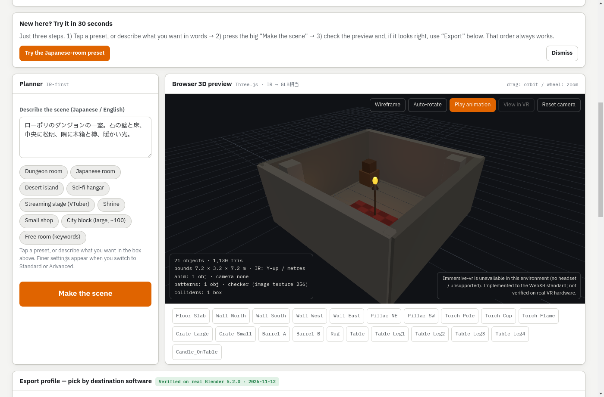
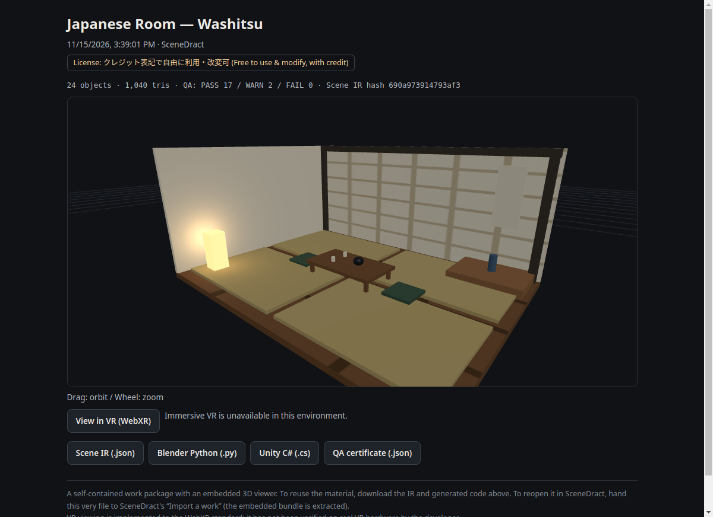
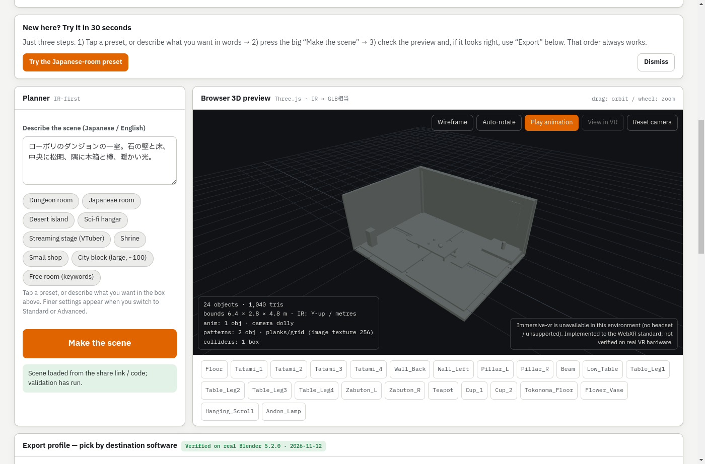

# Web プレビュー（Three.js）実描画の検証記録 — 2026-11-16

これまで「未検証」とされていた Three.js 描画系の3経路を、実際のレンダリングで検証した記録です。製品コードの変更はありません（描画の欠陥は見つかりませんでした）。

## 検証方法

- Electron 34.5.8（アプリ同梱と同じ実行環境）＋ Xvfb 上で `app/SceneDract.html` をそのまま開き、WebGL はソフトウェアレンダリング（SwiftShader / WebGL 2.0）で描画。
- 確認は「画面が真っ白でないこと」を目視だけでなく数値でも行いました: WebGL キャンバスの実ピクセルをサンプリングした色数、描画コール数・三角形数、全オブジェクトのメッシュ位置と Scene IR の座標の一致、コンソールエラーの有無。
- あわせて、起動時に自動実行されるアプリ内蔵の自己監査（生成コード監査レイヤー1）を回帰確認として読み取りました。

## 結果

### 1. アプリ内プレビュー（既定シーン: ダンジョンの一室）

- Three.js r158 が読み込まれ、フォールバック表示（CDN 到達不可の案内）は出ずに WebGL 初期化に成功。
- Scene IR の 21 オブジェクトに対しメッシュ 21 件が生成され、全メッシュの位置が IR の座標と完全一致（ずれ 0 件）。
- 描画コール 22 回 / 1,210 三角形。キャンバスのサンプル 4,886 点で 139 色、背景色の割合 66.5%（残りは壁・床・松明・木箱・絨毯などの描画）。
- コンソールエラー 0 件。

### 2. アプリ内プレビュー（UI フローで生成: 和室プリセット）

- プリセットの依頼文を入力欄にセットし「シーンを作る」を実際にクリックして生成。
- 24 オブジェクト / メッシュ 24 件、全位置が IR と一致。描画コール 25 回 / 1,140 三角形。コンソールエラー 0 件。
- 生成直後は段階1（ブロックアウト）のためグレー表示になるのが仕様どおりの挙動です。

### 3. 作品パッケージ（.html）の受け手側ビューア

- アプリ自身の `buildPackageHtml()` で Three.js 内蔵のパッケージ（約 822 KB）を生成し、単独ファイルとして開いて検証。
- パッケージ側ビューアが和室シーン（24 オブジェクト）を描画。合成済み画面のピクセルサンプル 8,876 点で 469 色、コンソールエラー 0 件。

### 4. 共有コードの受け取り側

- 送信側ウィンドウで和室シーンの共有コード（1,504 文字）を発行し、まっさらな別ウィンドウを `#s=` 付きリンクで開く受け取り経路を検証。
- 受け取り側で同じシーンが復元され（24 オブジェクト / メッシュ 24 件）、Scene IR ハッシュが送信側と完全一致（`690a973914793af3`）。復元されたシーンの描画ピクセルも実測で確認。コンソールエラー 0 件。

### 5. 回帰確認（自己監査）

- アプリ内蔵の自己監査: **5,038 / 5,038 チェック全合格**（8 プリセット × 11 書き出しプロファイルの bpy 文監査＋ルールシミュレーション＋ Unity C# 静的チェックリスト、表示モード整合・言語整合を含む）。失敗 0 件。

## 観察事項（欠陥ではないもの）

- Three.js r158 の非推奨警告がコンソールに出ます（`outputEncoding` / `Texture.encoding` は `outputColorSpace` / `colorSpace` へ移行）。実測したところ、r158 では旧プロパティへの代入が新プロパティへ正しく写像されており（レンダラーの出力色空間 = sRGB、模様テクスチャの色空間 = sRGB）、描画結果に影響はありません。Three.js の版を上げる際には合わせて移行が必要です。
- 検証環境（この VM）から CDN へはプロキシ経由のため、ハーネス側でのみ証明書検証を緩和して接続しました。通常の利用環境では直接接続される経路であり、アプリ側の扱いは変えていません。

## 残る未検証事項

- Unity 6.3 実機での生成 C# のコンパイル・実行（従来どおり未検証）。
- VR 実機（Quest 等）での WebXR 動作（従来どおり未検証）。
- Blender 実機の検証範囲は従来どおり（生成コードの実走は利用者側の Blender 5.2 が最終確認）。
- デスクトップ版の更新フローの実機ドリル（旧版→新版）は未実施。
- 本検証の WebGL はソフトウェアレンダリングです。実 GPU での表示は通常のブラウザ描画の範囲ですが、GPU 固有の不具合までは保証しません。
